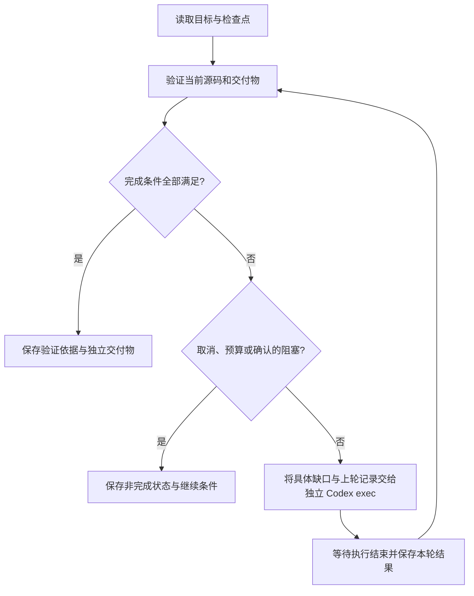

# 长时间自动化逆向：Goal Loop

状态：完整源码工程闭环仍是长期方案。最小结果保存与失败交接循环已经在 [V0.31](../milestones/v0.31/PLAN.md) 的通用 harness 修复中实现，完整候选构建与语义差分仍属后续范围。需求依据见 [REQUIREMENTS.md](../REQUIREMENTS.md)，整体设计见 [ARCHITECTURE.md](ARCHITECTURE.md)。当前批量生成函数候选的流程不等同于本文的工程级闭环。

本文维护任务循环、context 交接和记录/停止协议；具体运行与比较契约见 [动态差分设计](DIFFERENTIAL_EXECUTION.md)，本次实现子集见版本 PLAN。文档职责总览见 [文档入口](../README.md)。

产品入口是 LightRE 常驻 Python 服务：一个持久指导会话承接用户聊天，后台按任务管理多个 Codex CLI 工作会话。服务接收目标、组织任务上下文与内部指令、通过 agents 执行模型、调用功能模块进行真实检查、保存失败并组织下一轮。聊天连接与后台任务生命周期独立，关闭窗口不取消工作；空闲时服务等待请求，不重复调用模型。具体分层见[总体架构](ARCHITECTURE.md#常驻服务与指导会话待实现)。V0.31 先将服务、指导窗口与现有 harness/rehost 最小循环接通，静态批次保持一轮策略；这些新增整合及完整工程 Goal Loop 仍未交付。

## 产品目标

用户提交一次目标 SO、配套资料和交付要求，LightRE 在后台长时间自主完成调查、语义恢复、源码整理、构建、执行验证和代码优化，最终交付可以独立构建、继续维护的源码工程。用户无需逐函数发指令、逐轮点击继续或通过 UI 推动任务。

首要分析目标是 VM 混淆，重点解决其中的控制流平坦化与 MBA。每轮围绕阻碍业务语义恢复的具体缺口展开：VM 状态及 handler 语义、真实控制流、影响分支和输出的混淆表达式。静态调查、unidbg 实验、局部化简与验证相互反馈，不固定为单向流水线；文件组织和命名随已恢复语义整理。具体方法见 [核心分析路线](VM_RECOVERY.md#vm控制流平坦化与-mba)。这些动态和求解能力仍待实现。

分析进展按 [VM 语义恢复里程碑](VM_RECOVERY.md) 记录：可重放入口、取指、解码、dispatch、指令语义、逻辑控制流、业务源码。每轮明确当前阶段的范围、模型、证据与检查，完成条件由实际预测和运行结果支持；遇到反例时修正已有阶段结论，不按 LLM 调用次数推进。

Python 外层循环通过 agents 调用 Codex CLI，在每轮结束后验证实际工作区；验证未通过时，将具体缺口送回工作会话继续处理，通过目标验收后才结束。Codex 负责推理和工程修改，LightRE 服务负责执行、验证、持久化和停止判断。指导聊天与后台任务复用同一模型管理层，不另建独立 Agent 平台、消息中间件或调度服务。

系统界面提供指导聊天、结果浏览和任务控制。任务提交后由服务器自主推进，窗口关闭或暂时没有用户消息不影响后台工作；开发和排查仍可使用 CLI/API。指导窗口属于产品交互，trace/CFG/fuzz 面板不因此扩充。工具开发可以分步交付，成熟工具执行一次已授权的目标时应自动贯穿内部各步。

## 目标与完成条件

启动时将以下内容写入现有任务的 `task.md`，由调用方确定交付范围和完成条件：

| 内容 | 最少约定 |
| --- | --- |
| 目标范围 | 当前 SO、功能入口、必要状态和副作用、依赖及明确排除范围 |
| 源码工程 | 交付语言、接口、构建与运行命令、独立执行要求 |
| 行为验证 | 本任务的运行方式、观察与固定预期；双边差分任务另约定等义状态、比较规则及累计反例 |
| 工程质量 | 模块职责、类型和接口、文件与变量命名、依赖说明、未解决项 |
| 运行限制 | 调用方指定的预算、取消方式及可配置的故障重试限制 |

原始范围、检查器及固定用例的基准随任务登记。模型可新增实验和回归用例，但不能通过删除反例、跳过失败检查、修改预期或缩小范围取得通过。用户调整目标时登记新依据，原范围和既有验证记录仍可追溯。

“完全还原”按明确的交付范围检查。已识别函数数量不是全部逻辑的证明；VM 字节码入口、跨函数状态和外部副作用也可能属于目标。编译成功、模型说完成、生成所有函数候选或 CLI 退出码为零，均不足以认定目标完成。有限用例通过只说明相应范围内的验证结果。

## 单次循环



概念伪代码如下，函数名不表示已经提供对应 API：

```python
with exclusive_so_execution(workspace):
    goal, checkpoint = load_task(task_directory)
    while True:
        verdict = verify_current_artifacts(goal, workspace)
        save_checkpoint(verdict, checkpoint)

        if verdict.all_required_checks_pass:
            publish_verified_delivery(goal, verdict)
            mark_complete()
            break

        reason = confirmed_stop_reason(goal, checkpoint, verdict)
        if reason is not None:
            save_noncomplete_stop(reason, verdict)
            break

        instruction = compose_next_instruction(
            goal, checkpoint.previous_round_refs, verdict
        )
        result = execute_skill_via_agents(instruction)  # 通过统一 agents 执行；默认独立 exec --ephemeral
        save_round_result(result, checkpoint)
        classify_execution_failure_and_apply_retry_policy(result, checkpoint)
```

恢复时先检查已有产物，避免在上次已经完成验证、尚未来得及更新状态时重复调用模型。CLI 异常后也重新检查实际文件；部分修改既不自动丢弃，也不沿用旧通过结论。最终交付须绑定通过检查的源码版本，发布前复核内容未变；导出失败或交付物缺失时不写 complete。

## Codex 调用与上下文

默认每轮使用独立的 `codex exec --ephemeral`，由 LightRE 保存原始结果并显式组织下一轮 context，不依赖 Codex 会话持久化。若以后选择会话恢复作为局部任务的可选优化，首次不用 `--ephemeral`，从 `--json` 的 `thread.started` 事件保存明确的会话 ID，后续使用 `codex exec resume <SESSION_ID>`。自动化不使用 `--last`，避免其他分析任务或交互会话改变恢复对象。通过参数列表及 stdin 传入配置和任务正文，不拼接 shell 命令。

保存 JSONL 事件、stderr、进程退出及完整最终结果，初版直接保存 Markdown 原文，不要求 schema 或额外摘要处理。后续特定任务需要时可用 `--output-schema` 约束返回；结构化输出仍是模型报告，须由检查器核对。CLI 的一轮回复可以包含多次工具调用，无需为每条命令另起模型。实际参数以安装版本的帮助为准，选择可选恢复模式时另行验证恢复所需权限。

续跑提示包含原始目标、当前源码和知识引用、本轮验证失败、日志位置、已尝试方法及剩余工作。它描述具体问题，例如“结构体声明冲突导致构建失败，修复后继续运行已有差分用例”，而非只重复“继续”。

每轮默认从任务、当前文件、上一轮完整结果、实际检查及相关实验记录组织 context。可选 resume 模式遇到会话不可恢复或上下文不适用时，同样从这些文件继续。工作区是持久事实来源；Codex 会话只是可复用上下文。模型上下文压缩不影响 LightRE 保存的目标、原始证据和反例。

需要恢复会话的工程执行流程不能使用 `--ephemeral`，该选项不保存会话 rollout；即使自己的事件文件中捕获到了 thread ID，也不能据此假定该会话可恢复。当前 V0.2 的 `src/recovery/jobs.py` 每批仍使用 `exec --ephemeral`，保存 `.result.json`、`.events.jsonl` 和 `.stderr.log`，将有效代码与 notes 发布到源码和 `knowledge.md`，后续读取这些当前内容；它没有恢复前一批 Codex 会话，也没有系统地将上次执行错误与尝试记录注入重试 prompt。队列的 resume 是恢复 LightRE 任务，不是 CLI 的会话 resume。此处是现状说明，不要求为工程循环直接改变 V0.2 的单轮策略。

## 轮次记忆与纠错

单次 exec 内 Codex 已可进行“选择行动 → 调用工具 → 读取结果 → 调整行动”。Python 外层循环则围绕更大的工作单元组织同样的反馈：提交具体问题、等待工程修改、核验真实产物、保存观察和纠正、组成下一轮输入。不为每条 shell 命令另起 exec，也不要求输出内部推理过程；保留简短的决策依据和可核对的行动即可。

显式交接作为主方案，resume 只作为可选优化；文件记录保证换会话、压缩或中断后仍能续做。新的 exec 不会自动读取上次 result；即便 resume，也要明确传入执行器在上一轮结束后得到的新检查报告。模型不能凭会话中的旧成功结论跳过当前验证。

### 最小落地：先完整保存返回正文

V0.31 的 harness 专用执行器位于 `src/execution/loop.py`，运行与重放入口位于 `scripts/harness.py`，实现与实际检查见 [交付记录](../milestones/v0.31/DELIVERY.md)。下文的完整工程循环仍属后续范围；目前修复执行器消费任意目标的显式固定契约；真实模型修复在 smoke 上验证，DG/minilua 自动修复尚未实测。

先保留实际收到的最终返回文字，不要求额外模型调用做摘要、自动提取记忆或维护复杂结构化状态。后续需要筛选、纠错或压缩时，再从这些原始记录派生，不能覆盖原文。最小轮次目录约定如下，V0.31 已用于 harness 专用循环；完整工程循环仍待实现，不改变 V0.2 逐函数 JSON 的返回协议：

```text
tasks/<task_id>/
  task.md
  state.json
  round-0001/
    prompt.md           # 实际传入的完整任务正文
    result.md           # Codex 实际返回的完整最终正文，不改写、不截取
    events.jsonl        # --json 实际输出的事件流
    stderr.log          # CLI 错误输出
    execution.json      # 程序记录命令、工作目录、起止时间、退出码、超时/中断及结果文件情况
    verification.json   # 外部检查的真实结果和详细日志引用；未执行明确记为未执行
  round-0002/
    ...
```

使用 `-o <本轮目录>/result.md` 保存最终回复，stdout 的 JSONL 和 stderr 分别直接写文件。工程循环初版不使用 `--output-schema` 强制最终正文格式；可以要求报告说明已做工作、错误、修改文件及剩余项，但返回内容仍原样保留。`result.md` 只有最终回复，不包含全部工具过程，调查需要的原始编译/运行日志另外保存并引用。若某类任务本来要求 schema，则保留完整 `result.json`，不为了 Markdown 改掉它的业务协议。

“上一轮”由当前任务的 `state.json` 引用已经结束的轮次目录，不能通过全局 `latest` 或另一任务的文件确定。每次尝试使用新目录；失败也保留。只有在进程与相关写入结束后才交接，异常/中断造成 result 缺失、为空或仅有部分内容时记录实际情况，不编造最终报告、不拿旧轮正文补位。CLI 退出码、result 是否存在与业务检查是否通过分别记录，不混成一个成功标记。

下一轮 prompt 先引用原始任务，再明确要求读取上轮 `result.md`、`execution.json`、`verification.json`，按需查事件和原始日志，并核对当前源码。初期无需自动抽取记忆；若本轮禁用读取文件的工具，调用方将相关原文直接作为输入材料传入。结果正文和日志属于待核对材料，不能覆盖原任务约束或固定检查依据。

历史原文一直保留，下一轮默认只带上轮及相关旧记录的引用，不把所有返回文字无限追加到 prompt。上轮的“完成”是模型报告，外部检查才说明具体检查是否通过；没有行为检查时只能报告修改和执行情况。后续再按实际需要实现下面的知识整理与纠错约定，不把记忆提取系统设为保存结果和续跑的前置。

沿用已有任务和轮次目录，不另建 memory 数据库。按以下职责保存：

| 记录 | 内容与使用方式 |
| --- | --- |
| `task.md` | 原始目标、完成条件和约束，续跑时持续引用 |
| `round-<编号>/` 中的事件、stderr 和模型结果 | 保留实际调用与本轮报告；模型摘要不是独立验证结果 |
| 同轮的检查报告 | 执行器记录真实命令、退出码、观察、反例和内容依据；进程失败或结果缺失也有记录 |
| SO 的 `knowledge.md` | 当前事实、假设、未知、已尝试方法和被修正的结论，引用相关轮次或 Run；保留具体证据而非不断压缩成主题摘要 |
| 下一轮 prompt | 原任务引用、当前状态、上轮结果与检查报告引用、相关旧失败及本轮优先问题；只展开相关摘要，不重复全部历史日志 |
| `state.json` | 执行器维护任务、轮次与上述记录的引用；CLI 会话 ID 仅在可选恢复模式下使用，避免再复制一套可独立变化的知识正文 |

以下内容用于引导模型写出可继续工作的报告，不作为初版强制 schema 或自动记忆提取协议；执行器原样保留返回，即使格式不完整也不能丢弃。报告应尽量表达：

1. **问题与假设**：本轮试图解决什么，依据和未知是什么。
2. **实际行动**：尝试了哪些方法、修改了哪些文件，命令和详细输出在哪里。
3. **观察与检查**：得到什么结果，绑定哪个源码/产物、harness、输入与环境；模型报告和外层核验分别标明。
4. **结论修正**：哪些旧判断被支持、反驳或仍待验证，引用原记录、新证据与适用范围。
5. **未解决项与下一步**：保留相关失败和已试方法，提出一个可执行的后续行动及预期检查。

执行器保存本轮结果和外部检查后，再组织交接。模型对知识的修订也须说明证据；外层的格式与内容依据核对不等于自动证明所有语义判断正确。新观察与模型自评冲突时，下一轮明确指出冲突，不将自评的“已修好”抄成事实。若 CLI 异常或最终结果缺失，仍保留日志、核对实际文件并给出失败交接，不将摘要缺失理解为没有修改。

纠错遵循以下约定：

- 保留原尝试及修正关系，不删除反例来消除矛盾；当前知识中明确标记旧结论已被什么证据修正，不能让失效结论继续以事实身份流传。
- 只在实验确实执行且前提满足时据结果修正语义假设。编译失败、JNI 缺失、超时或输入无效只说明实验未完成，不能据此否定目标算法或路径。
- 同一条件下失败的同一方法不机械重试；说明修改了什么输入、代码、环境或假设，以及重试为何有新依据。基础设施故障仍按重试策略处理，不永久禁止可能有效的方法。
- 源码、harness、用例或环境改变后，核对已有观察是否仍适用；旧通过和旧失败均不自动覆盖新内容。失败用例保留用于回归。

外层循环可概括为：`读取任务与已有记录 → exec 行动 → 保存本轮结果 → 实际核验 → 失败交接 → 下一轮`。是否完成仍由任务要求的实际检查决定，下一步由 Agent 根据当前证据选择。[V0.31](../milestones/v0.31/PLAN.md) 已实现这条最小链路，固定契约可由目标提供；当前知识的自动提炼、通用工程验收、候选构建和语义差分后续接入，不能因 harness 任务通过就宣称完整 Goal Loop 已完成。

## 工程恢复 Prompt

指令按本次任务范围选用。V0.31 只传入 harness 调整、授权工程路径、固定测试 SO、输入/预期和最新失败，不套用完整业务恢复指令，也不要求生成候选 SO、双边差分或知识提炼。以下两个模板服务于后续明确包含这些内容的工程任务。

文件划分、类型恢复与命名使用固定的 [逐轮恢复指令](../../src/recovery/prompts/RECOVER_AND_REFINE.md)。它是 LightRE recovery 功能内部的运行时资源，与所属模块一起保存在 `src/recovery/prompts/`，设计说明保存在 `docs/`。工程执行器接入时由该模块读取指令、拼入任务上下文并调用 Codex，用户通过 LightRE 提交任务，无需手动读取此文件、拼装 prompt 或安装为 Skill。

任务包含候选构建、运行或差分时，同时加入 [构建与验证 workflow](../../src/recovery/prompts/BUILD_AND_VERIFY.md)。单次 exec 内由 Codex 反复处理编译、链接、加载、ABI、运行和语义失败；外层 Python 循环在 exec 结束后核对实际产物，仍未满足任务时携带具体失败续跑。两层配合，不为每条构建命令新起会话，也不让模型递归调用 Codex。workflow 约定方法，构建脚本、unidbg harness 和外部检查器提供可复现的实际检查。

每轮交给 Codex 的提示由三部分组成：固定指令、原始任务的路径与必要约束、本轮上下文。本轮上下文明确当前 SO 分析目录、可编辑的源码或独立草稿目录、本轮结果目录、最新检查报告和优先缺口；首轮没有历史报告时明确说明。输入采用路径引用，按需读取原始证据，不把所有历史正文反复拼入提示。

调用方用参数列表启动 `codex exec -`，将完整提示通过 stdin 传入，并按任务范围配置源码写入权限；CLI 默认只读，方法文档不会改变沙箱权限。后续可恢复明确会话 ID，但仍提供最新上下文并读取当前产物。方法文档不能替代每轮任务，也不会自动赋予当前批量候选任务跨文件写入权限。调用方式参见 [OpenAI 官方非交互执行文档](https://developers.openai.com/codex/noninteractive/)。

循环根据实际缺口推进，例如先补齐一个入口的调用链，再恢复共享对象与字段，随后统一类型和接口、按职责整理文件；发现反例则回到相应语义调查。该顺序不是固定轮次流水线，也不要求每轮都修改源码。新增证据、排除假设和保存反例可以构成进展；反复换名或模型自评变好不构成通过依据。

执行器每轮保存实际使用的 prompt、模型结果、事件、检查日志及对应源码依据，检查未通过时携带具体失败和累计知识继续。用户明确指定轮次或预算时，到达上限保存当前结果与剩余项，不能因此标记完成。达到既定交付条件时结束，不为了凑轮次继续修改。

目前只提供上述可复用指令及接入约定，尚未实现工程级执行器。现有 `src/recovery/jobs.py` 仍采用只读调查、按 RVA 返回 JSON 的批量提示，不能直接套用其保存方式执行跨文件重构。

## 验证与修改范围

检查器由 LightRE 维护，在 Codex 本轮进程及相关写入结束后检查当前产物。报告至少关联目标版本、实际源码内容、构建产物、检查器、所用 harness、用例和相关环境依据；通过版本 ID、内容哈希与 Run 引用表达，避免重复保存正文。验证前后确认输入未变，变化时该次报告不能作为当前通过依据。

V0.31 的外层检查只构建和运行授权 harness，核对固定测试 SO 的整数返回、有效缓冲区长度与内容及重放结果；测试 SO、预期和外部检查器保持固定。该范围通过只代表 harness 任务完成。

以下五项是后续完整源码恢复任务的交付检查，按任务范围逐步接入，不要求 V0.31 提前实现：

1. 工程可以按交付说明构建，接口和依赖齐备。
2. 声明交付的入口可以独立运行；占位代码、原 SO 代算及影响范围的 Unknown 仍属于未完成项。
3. 原实现与候选实现按含义一致的输入状态执行，比较声明的返回值、输出与副作用，并运行累计反例和组合用例。
4. 代码直接表达恢复后的逻辑，文件按职责组织，名称、类型和公共定义一致，构建及维护说明齐备。
5. 独立导出物与所验证的源码一致，可以从交付目录按说明构建和调用。

构建、运行和比较结果可程序化核对。语义缺口与可维护性需要 Agent 对照源码和证据审查，保留理由；不能用命名规则或另一次模型声称“通过”代替行为验证。

工程任务按原始任务的明确授权，允许 Codex 修改相应源码、构建文件、harness 或调查脚本，经 LightRE 的发布与记录约定保存；V0.31 仅授权 harness 工程。执行器独占更新任务状态和验证汇总；原始 SO、目标基准和固定验收依据不由模型任意改写。该模式不沿用当前批量任务“只读调查并返回函数 JSON”的权限边界，不能直接取消现有边界便宣称完成接入。

## 源码恢复与优化

工作单位围绕功能入口、调用链或模块，可以跨越多个原始函数。源码声明采用独立身份，RVA 保留为来源；允许合并、拆分、抽取 helper 和恢复共享类型。当前按 Ghidra 分组、按固定函数数打包的模块只是初稿，不限定最终工程布局。

先恢复行为，再通过累计验证整理控制流、模块、类型、接口和命名，必要时进行有依据的性能优化。重构和优化后重跑受影响范围的验证，不能沿用修改前的通过结论。需要保留的已验证版本和独立交付物不被失败尝试覆盖。

自动新增功能可以复用同一循环，但应作为后续明确目标：新需求定义预期变化，既有回归保护其余行为，原始行为与新增逻辑可追溯。它不混入一次尚未完成的语义还原任务。

## 持久化、互斥与停止

沿用每 SO 的 `tasks/<id>/`，不增加 goal 数据库或重复状态层：

- `task.md`：原始目标、范围、完成条件及后续处理摘要。
- `state.json`：LightRE 独占维护的当前状态、轮次、停止原因、最新报告引用和继续条件；会话 ID 为可选恢复模式的附加信息，不是续做前提。
- `round-<编号>/`：每轮的提示、事件、stderr、模型结果及验证报告；续跑递增编号，保留既有记录。
- 源码、知识、Run 和 Evidence 继续使用各自的权威位置，本轮仅引用实际采用的版本与产物。

具体文件名和字段在实现时按需加入。状态与停止原因分开保存，只有目标验收全部通过才可标记 complete。模型声明完成或阻塞仅作为待核对报告，执行器结合当前产物、失败记录和明确缺失条件确定最终状态。

| 情况 | 外层处理 |
| --- | --- |
| 源码构建或差分失败 | 保留失败与反例，把具体缺口反馈给 Codex |
| 检查器报错、报告缺失或过期 | 保持未验证，保存错误，按故障策略处理 |
| 网络、限流或 CLI 异常 | 分类记录，按可配置上限退避重试，耗尽后保留非完成状态 |
| 相同尝试反复失败 | 比较代码、证据、用例与知识的变化，要求调整方法或补充条件，避免机械重试 |
| 已确认缺少必须的资源或外部输入 | 保存阻塞依据、已完成范围及解除条件 |
| 用户取消或预算耗尽 | 停止新增调用，处理在途进程，保存可恢复检查点 |

没有源码变化不等于没有进展；新证据、反例、已排除的假设也属于有效推进。不建立通用评分引擎，不因固定几轮没有代码差异便宣布阻塞。预算由调用方明确设置，未设置时不虚构 token 限额；基础设施重试也不能成为无上限的空循环。

同一 SO 继续使用唯一执行锁，与已有批量分析和评论队列协调；共享 harness 工程同样保持单一写入者，跨 SO 任务不能同时覆盖它。一次 `exec` 结束不等于所有后台工具已退出，必须明确其生命周期后再验证或启动下一轮。取消和恢复均校验进程身份，重启后确认旧执行者结束，再读取检查点继续。

## 最小实施与验证

V0.31 已用 smoke 验证最小 Python 循环，接通外部检查、完整结果保存和失败续做，并按后续授权增加 DG/minilua 单边运行。接下来由真实候选构建与双边差分扩展。默认独立 exec，不以会话恢复或自动记忆提炼为前置；工具能力的引入时机见 [后续开发路线](../ROADMAP.md#能力引入顺序)。以下是完整能力逐步实现所需的检查，不要求在 V0.31 完成全部工程与真实 VM 场景：

1. 使用临时工程与模拟 CLI，验证首轮声称完成但检查失败时自动续跑，当前文件通过后才结束。
2. 覆盖退出码为零但结果缺失、旧验证报告、检查器异常、执行中断、取消、重试上限、执行互斥和从轮次文件恢复；后续引入可选 resume 时再检查会话不可恢复的回退。不依赖浏览器或真实模型做常规测试；V0.31 的真实 unidbg 运行与真实 Codex harness 修复另按本版计划记录。
3. 在一个真实小函数上打通原始运行、候选构建、差分、保存反例及修复回归，由一次提交自动完成各步。
4. 扩大到调用链和模块，在同一目标中验证共享类型、跨文件修改、合理命名及独立源码交付，再进行长时间真实样本试跑。

阶段验证服务于完整目标自动完成，不把人工逐轮确认或 UI 操作加入日常执行链路。CLI 机制试验不能代替真实样本的语义恢复验证。

## CLI 调研依据

2026-10-31 在本机 `codex-cli 0.162.1` 上，以临时工作区和本地模拟 Responses 服务验证，未调用真实模型：

- `goals` 功能已启用；`exec` 可调用目标工具并保存 active 目标，但最终回复后仍可退出。通过明确会话 ID 恢复后，可读回同一目标并完成状态更新。
- `Stop` hook 返回阻止停止的反馈后，同一个 `exec` 成功继续下一轮；检查器错误退出或返回无效 JSON 时，进程仍可能以退出码零结束。

因此外层验证与循环由 LightRE 自己负责。原生目标和 hook 可作为以后按需使用的辅助能力，不承担唯一的完成保证。以上是该版本的机制验证，不能外推为所有版本的行为承诺。

官方文档：[非交互执行与恢复](https://developers.openai.com/codex/noninteractive/)、[CLI 命令](https://developers.openai.com/codex/cli/reference/)、[配置参考](https://developers.openai.com/codex/config-reference/)、[生命周期 hooks](https://developers.openai.com/codex/hooks/)。
