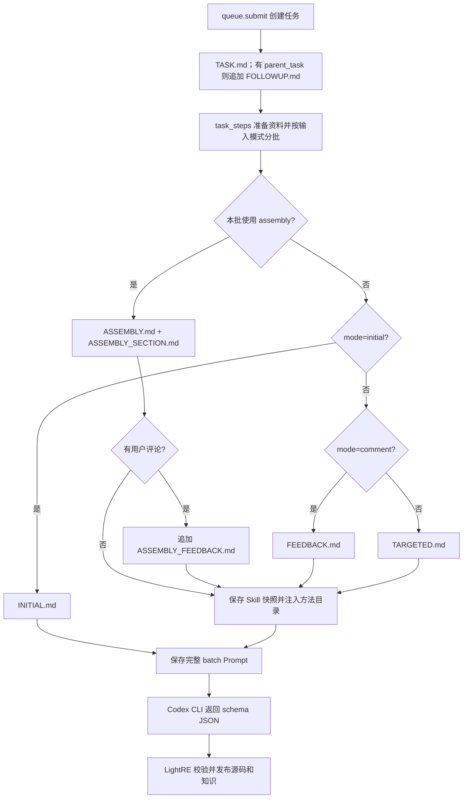

# Recovery Prompt 与内部 Skill 映射

当前 Recovery 包含 12 份 Prompt／文档模板，以及 3 个内部 Skill 和 2 份配套参考文档。Python 选择每批任务的范围、输入模式和输出协议；允许工具的批次注入方法目录，由 Codex 自行选择并读取适用 Skill。全部资源均有实际调用入口，不会每次一起加载。

通用模板规范和发布规则见 [PROMPTS.md](PROMPTS.md)。下文的 `<analysis>` 指当前 SO 的分析结果目录，也是 Recovery 启动 Codex CLI 时的工作目录。

## 全部模板映射

### 4 份主指令：每批只发送其中一份

| 模板 | 代码入口 | 实际发送条件 | 输入与职责 |
| --- | --- | --- | --- |
| [INITIAL.md](../../src/recovery/prompts/INITIAL.md) | [jobs.py](../../src/recovery/jobs.py) 的 `_initial_prompt()`，由 `_start_batch()` 调用 | `mode=initial` 且本批不是 assembly | 内嵌初稿、知识及必要的汇编上下文；快速做一轮保守整理，禁止使用工具或额外调查 |
| [ASSEMBLY.md](../../src/recovery/prompts/ASSEMBLY.md) | [assembly.py](../../src/recovery/assembly.py) 的 `assembly_prompt()`，由 `_start_batch()` 调用 | 任务指定 `input_mode=assembly`，或本批函数全部被标为 assembly；此判断优先于 initial/comment | 内嵌本批每个函数的全部已保存汇编、知识和材料清单；从汇编生成 C，必要时只读核对原 ELF |
| [FEEDBACK.md](../../src/recovery/prompts/FEEDBACK.md) | [jobs.py](../../src/recovery/jobs.py) 的 `_feedback_prompt()` | `mode=comment` 且本批不是 assembly | 用户建议、执行时的当前源码和知识；候选变动时还提供 `reviewed.c`。仅处理本条建议，优先返回精确补丁和独立回复 |
| [TARGETED.md](../../src/recovery/prompts/TARGETED.md) | [jobs.py](../../src/recovery/jobs.py) 的 `_start_batch()` | 不满足上述条件，通常是 `mode=targeted`、`input_mode=reference` | 任务路径、本批 RVA、参考伪代码、模块及边界信息、只读工具位置；按需读取候选、知识与汇编，完成指定函数分析 |

四类最终都返回受 JSON schema 约束的逐函数结果。完整源码／补丁、知识、评论回复等字段随模式变化，schema 由 `_schema()` 生成；模型不直接保存候选，发布由 `_publish_batch()` 处理。

### 2 份补充要求：仅在特定条件使用

| 模板 | 代码入口与条件 | 去向与用途 |
| --- | --- | --- |
| [ASSEMBLY_FEEDBACK.md](../../src/recovery/prompts/ASSEMBLY_FEEDBACK.md) | [jobs.py](../../src/recovery/jobs.py) 的 `_start_batch()`；同时满足 assembly 和 `mode=comment` | 追加到 `ASSEMBLY.md` 渲染结果后；要求独立 `reply`、完整整合的 `notes`，并规定本模式不使用源码／知识补丁 |
| [FOLLOWUP.md](../../src/recovery/prompts/FOLLOWUP.md) | [queue.py](../../src/recovery/queue.py) 的 `submit()`；传入 `parent_task` 时 | 渲染后追加到新任务的 `task.md`，说明上轮未解决函数需要续做；不是无条件追加到每批主指令 |

`FOLLOWUP.md` 主要保留给历史任务兼容：新任务的 `auto_refine=False`，不会默认在首轮结束后自动创建续做任务。`task_steps()` 仍会对记录了 `auto_refine=true` 的旧 initial 任务调用 `submit(..., parent_task=...)`；也可由调用方显式传入 `parent_task`。不能把“代码仍引用它”理解为“当前默认流程都会触发它”。

### 5 份任务／输入／输出文档模板

| 模板 | 代码入口与条件 | 生成位置或使用位置 |
| --- | --- | --- |
| [TASK.md](../../src/recovery/prompts/TASK.md) | [queue.py](../../src/recovery/queue.py) 的 `submit()`；每个实际创建的新任务 | `<analysis>/tasks/<id>/task.md`；记录 RVA、输入模式、用户意见和提交时的候选 SHA256。`TARGETED.md` 明确要求读取它；INITIAL/FEEDBACK 的任务上下文直接内嵌，不能假定模型每次都会打开此文件 |
| [ASSEMBLY_HEADER.md](../../src/recovery/prompts/ASSEMBLY_HEADER.md) | [assembly.py](../../src/recovery/assembly.py) 的 `assembly_prompt()`；每个 assembly 函数 | `batch-NNNN-0x........asm` 的头部；记录 RVA、SHA256、保存的 image_base、ranges 及边界可能遗漏的提示。正文原始机器码／汇编由 Python 输出 |
| [ASSEMBLY_SECTION.md](../../src/recovery/prompts/ASSEMBLY_SECTION.md) | 同上；每个 assembly 函数 | 渲染为知识和全部已保存指令的正文片段，再通过 `SECTIONS` 内嵌进 `ASSEMBLY.md`；不会单独启动模型 |
| [SOURCE_README.md](../../src/recovery/prompts/SOURCE_README.md) | [candidates.py](../../src/recovery/candidates.py) 的 `save_candidate()`；保存候选且 README 尚不存在 | `<analysis>/source/README.md`；解释模块组织、身份标记、派生索引及候选尚未验证。不是每批 Prompt 的固定组成 |
| [KNOWLEDGE_HEADER.md](../../src/recovery/prompts/KNOWLEDGE_HEADER.md) | [knowledge.py](../../src/recovery/knowledge.py) 的 `_header()`；知识文件创建或迁移重建时 | `<analysis>/knowledge.md` 的文件头；记录 Binary 和 SHA256。函数知识正文另由程序按 RVA 组织，不是另一轮模型调用 |

### 1 份内部方法目录模板

| 模板 | 代码入口与条件 | 去向与用途 |
| --- | --- | --- |
| [SKILLS.md](../../src/recovery/prompts/SKILLS.md) | [skills.py](../../src/recovery/skills.py) 的 `skill_catalog()`；`_start_batch()` 构建的主指令不是 INITIAL 时 | 在主指令前注入可用方法的名称、描述与快照绝对路径；不内嵌 Skill 正文。元数据从各 Skill 的 YAML frontmatter 读取 |

## 当前调用关系

任务模式由 `queue.submit()` 决定：非空评论优先成为 `comment`；否则显式传入 `rvas` 成为 `targeted`；未传 `rvas` 成为 `initial`。`input_mode` 则独立指定为 `reference` 或 `assembly`。

默认 reference 首轮中，某个函数既没有参考伪代码、也没有当前 C 候选时，`task_steps()` 会将该函数切换为 assembly。`_batches()` 按输入模式拆批，因此同一个 initial 任务可能出现 INITIAL 和 ASSEMBLY 两类批次。

`_start_batch()` 只渲染实际选中的主指令。INITIAL 不生成 Skill 目录或快照，并继续禁用 shell 工具；默认首轮中切换为 assembly 的批次则注入汇编方法。

## 如何核对某次实际使用了什么

每次实际发送给 Codex 的完整正文保存在 `<analysis>/tasks/<id>/batch-NNNN.prompt.md`。这是核查该批输入的直接依据；目录里存在 `task.md`、README 或 `.asm` 文件，不等于模型已经读取它。

同目录还保存 `batch-NNNN.schema.json`、`.result.json`、`.events.jsonl` 和 `.stderr.log`；initial/reference 与普通评论批次还保存 `.input.json`，供补丁重放及发布校验。assembly 批次保存逐函数 `.asm` 和 `.knowledge.md` 输入快照。`state.json` 记录任务模式、输入模式、批次状态及父任务关系。

注入方法目录的批次另保存 `batch-NNNN.skills/` 文档快照和 `batch-NNNN.skills.json` 清单。清单记录可用 Skill 的名称、描述、入口绝对路径，以及每份文档的相对路径和 SHA256；CLI 读取的是该批快照，程序升级不会改变正在执行批次的方法正文。清单表示提供了哪些方法，实际读取情况应结合 `.events.jsonl` 中的工具执行记录检查。

## 有没有多余或重复的内容

当前没有完全无引用的 Recovery 模板。12 份模板并不代表 12 个 Agent 或 12 轮执行：大部分是文档片段、目录和条件补充，主指令每批只选一份。`FOLLOWUP.md` 属于默认不触发的兼容分支，是否移除应与旧任务续做支持一起决定。

四份主指令确实重复了部分规则，例如 RVA 身份、只读分析、不编造缺失实现、知识整合和未经验证声明；但工具权限、证据来源和输出方式存在区别。尤其 INITIAL 禁止工具，ASSEMBLY 禁止用 Ghidra 伪代码替代汇编分析，FEEDBACK 要限制修改范围，不能仅为减少文件数而直接合成一份通用长 Prompt。

汇编恢复、候选核对和评论处理的方法已抽取为 Skill，地址换算、边界与参考核对细节放在按需读取的 references 中。任务数据、输出 schema 和必须始终遵守的质量／发布约束仍明确传给每一批。

## 已实现的内部 Skill 注入

这里的 Skill 是 LightRE 内部的方法文档，只在 LightRE 启动自己的 Codex CLI 时注入。模块维护并随包发布，调用方无需另行安装或配置。

采用“任务 Prompt + 内部 Skill 目录”的方式：LightRE 在初始 Prompt 中注入本次可用方法的名称、适用描述和文档绝对路径；Codex 根据任务选择并只读加载所需正文，再按需读取 references。目录的注入说明维护在模块的 Markdown/Jinja2 中，Python 负责提供资源路径和元数据。

这种内部按需读取方式借鉴了 [OpenAI 官方 Agent Skills 文档](https://developers.openai.com/codex/skills/)的渐进加载机制，但由 LightRE 自己提供目录，不依赖原生 Skill 搜索或注册。因此不要求复制到 `<analysis>/.agents/skills/`、修改用户全局配置或制作外部分发插件，也不能将它描述为已经接入了 Codex 原生 Skill 注册机制。

### 方法文档与可用范围

| 方法来源 | 当前资源 | 选择边界 |
| --- | --- | --- |
| ASSEMBLY 的汇编恢复方法 | [lightre-recover-assembly](../../src/recovery/skills/lightre-recover-assembly/SKILL.md) | 所有非 INITIAL 批次可用；从 ARM64 汇编形成 C 候选，评论任务只调查建议相关行为 |
| TARGETED 的参考对照与证据调查方法 | [lightre-refine-candidate](../../src/recovery/skills/lightre-refine-candidate/SKILL.md) | 非 assembly 的定向分析与评论批次可用；对照当前候选、参考和局部机器证据 |
| FEEDBACK 的评论处理方法 | [lightre-apply-feedback](../../src/recovery/skills/lightre-apply-feedback/SKILL.md) | 仅评论批次可用，包括仅汇编评论；任务仍限定本函数和本条评论 |
| ELF 地址与缺失块核对 | [ELF_ADDRESSES.md](../../src/recovery/skills/lightre-recover-assembly/references/ELF_ADDRESSES.md) | 汇编 Skill 在遇到地址／范围疑点时引导读取 |
| 参考失败、地址与 ABI 细节 | [REFERENCE_CHECKS.md](../../src/recovery/skills/lightre-refine-candidate/references/REFERENCE_CHECKS.md) | 候选核对 Skill 在出现参考缺失路径、halt_baddata 或边界疑点时引导读取 |
| INITIAL 的快速保守整理 | 保留为直接 Prompt | 当前明确禁止工具，CLI 也禁用 `shell_tool`，不能在此约束下依赖模型读取 Skill 正文或 references；若迁移必须调整调用契约 |
| TASK、汇编头／正文片段、README、Knowledge 头 | 继续作为 Jinja2 数据／文档模板 | 它们负责承载任务或格式化材料，不是可自主选择的分析方法 |
| ASSEMBLY_FEEDBACK、FOLLOWUP | 分别归入评论任务条件和续做任务上下文 | 补充要求必须由实际任务触发，不能让模型自行猜测是否存在评论或父任务 |

### 执行边界与留档

1. **模块拥有源文件。** 在 `src/recovery/skills/<name>/SKILL.md` 与 `references/` 维护方法文档，沿用递归 Markdown 打包规则；名称与适用描述以 Skill 自身 frontmatter 为唯一来源，动态 RVA、路径、评论和知识仍由 Jinja2 任务模板提供。
2. **由调用方注入内部目录。** CLI 以 `-C <analysis>` 启动；LightRE 从模块安装位置读取所需文档并保存到本批 `.skills/` 快照，在 Prompt 中注入该快照的入口绝对路径，无需改变 Codex 的自动搜索目录。子进程需能只读访问快照及引用文档；如果以后改为隔离容器执行，需要使任务目录及其路径在容器内可用。
3. **保留每批任务外层约束。** LightRE 给出目标 RVA、允许的证据来源、只读权限、评论范围、输入和 schema；Codex 在该范围内选择适用 Skill，必要时继续读取其 references。自由选择分析方法不等于自由改变任务或发布方式。
4. **保持程序负责执行协议。** 队列、批次、锁、取消、超时／重试、SHA256 冲突检查、补丁校验和源码／知识发布继续由 Python 控制。Skill 输出仍走现有 JSON schema，不能改为任意写工作区。
5. **保留可追溯输入。** 完整批次 Prompt、方法文档快照与逐文件 SHA256 清单在启动 CLI 前保存。元数据无效会在启动前报错，不静默跳过损坏资源。快照包含所提供 Skill 的全部 Markdown，保留 references 的相对结构。
6. **验证真实选择行为。** [test_recovery_skills.py](../../tests/test_recovery_skills.py) 检查模式过滤、路径、快照完整性、引用解析和坏元数据；可显式启用真实 CLI 测试，验证汇编恢复、定向核对和评论三类任务读取 Skill 后仍能通过现有结果发布流程。运行方式见 [USAGE.md](../USAGE.md#recovery-内部-skill)。

当前某些模式传入 `--disable plugins/apps/multi_agent`；内部 Skill 的目录通过已有任务 Prompt 输入，正文通过允许的只读文件工具加载，不依赖这些扩展。仍需遵守各模式的工具限制，尤其 INITIAL 不能直接套用按需读取方案。

该实现让 Codex 在本批可用方法中自行选择如何调查，LightRE 继续控制任务范围和结果保存；方法目录不是额外的模型轮次，也不安装到用户或系统的 Skill 目录。
